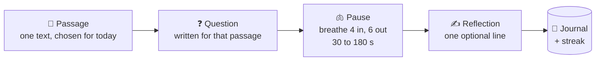
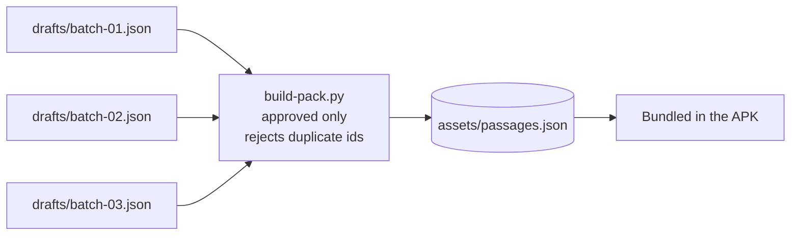

<div align="center">

# 🌒 The Quiet Hour

**Two minutes a day. One passage, one question, one pause, one line.**

A daily Stoic ritual for Android. You read a passage from Marcus Aurelius, Seneca or Epictetus, answer a single question written for it, sit with it through an enforced pause, and write one line back. It is a practice, not a quote feed.


</div>

---

## The ritual



Four full-screen steps with no chrome and nothing to scroll. The pause between reading and writing is the product: a breathing indicator with no countdown, the screen kept on, and an optional chime at the end.

## Engineering highlights

### Deterministic, never-repeating daily passage

Every install gets its own order, the same passage all day, and no recent repeats. The exclusion window shrinks with the pack, so a small pack always has a candidate ([`content/PassageSelection.kt`](app/src/main/java/br/com/rodsil/quiethour/content/PassageSelection.kt)):

```kotlin
val windowStart = date.minusDays(minOf(EXCLUSION_WINDOW_DAYS, passageIds.size - 1L))
val recentlyDelivered = deliveries.filterKeys { it >= windowStart && it < date }.values.toSet()
val candidates = passageIds.sorted().filterNot { it in recentlyDelivered }
return candidates[Math.floorMod("$installId$date".hashCode(), candidates.size)]
```

No server, no random seed to persist: the passage is a pure function of install id, date and delivery history.

### A streak that time travel cannot corrupt

The streak is derived only from local completion dates and modeled as a sealed type (`Active`, `AtRisk`, `Broken`). Time zone changes, DST and a user moving the device clock can only change what "today" means. They never rewrite stored state ([`ritual/Streak.kt`](app/src/main/java/br/com/rodsil/quiethour/ritual/Streak.kt)).

### A pause that survives the process

The pause is timed on a monotonic clock from a start instant that survives configuration changes and process death. Rotating the phone or getting killed in the background does not restart it.

### A content pipeline, not a hardcoded list



The current pack holds 30 passages, ten each from Marcus Aurelius, Epictetus and Seneca. Each one carries its source translation, reference, a question and historical context. Translations are public domain (for example George Long's 1862 *Meditations*).

## Features

- **Daily ritual:** passage, question, timed pause and reflection
- **Streak:** honest and local
- **Journal:** every finished day with its passage, question and reflection. Search, favorites and Markdown export through the share sheet. A missed yesterday stays readable but never counts toward the streak.
- **Settings:** pause length (30 to 180 s), chime, theme (system, light, dark, sepia) and font size, in DataStore
- **Private by design:** reflections never leave the device

> **Status:** in development. The daily ritual, streak, journal and settings work. Notifications, sharing and monetization come next.

## Tech stack

| Layer | Choice |
|---|---|
| Language | Kotlin 2.3, core library desugaring |
| UI | Jetpack Compose, Material 3, Navigation 3 |
| DI | Hilt |
| Persistence | Room with exported schemas (v1 to v3), DataStore |
| Content | kotlinx.serialization, Python build script |
| Platform | Min SDK 26, target SDK 36 |

## Project structure

```
app/src/main/java/br/com/rodsil/quiethour/
├── content/    Content pack model and daily passage selection
├── data/       Room database, repositories, settings
├── ritual/     Ritual flow, pause timer, chime, streak
├── journal/    Journal list, search, favorites, export
├── settings/   Settings screen
└── theme/      Colors, typography, themes
content/        Passage drafts and the pack build script
```

## Tests

| Suite | What is verified |
|---|---|
| `ContentPackTest` | Pack parsing and validation |
| `PassageSelectionTest` | Determinism, exclusion window, small packs |
| `StreakTest` | Streak states across time zone, DST and clock changes |
| `JournalTest` | Case-insensitive search, favorites filter, Markdown export order |

## Running

```bash
./gradlew assembleDebug
./gradlew testDebugUnitTest
```

Rebuild the content pack after editing the drafts:

```bash
python content/build-pack.py
```
